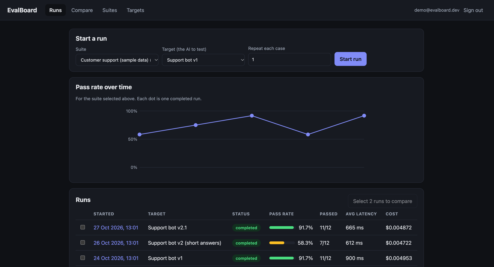
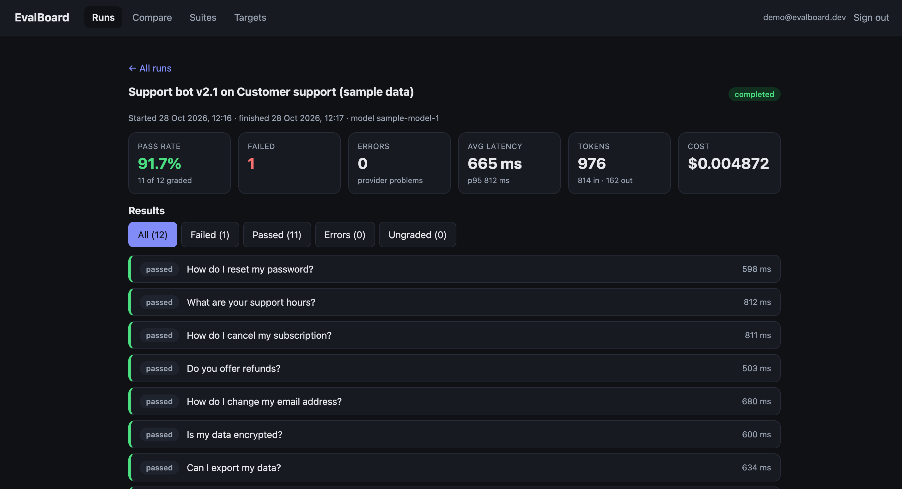
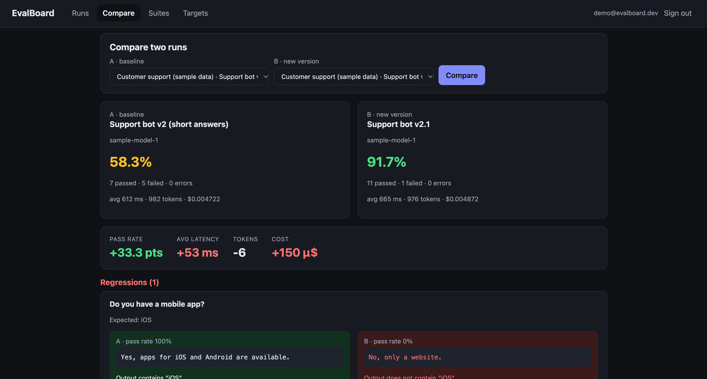

# EvalBoard

**An evals dashboard for any AI.** Bring your own API key, pick any model, run a suite of test questions against it, grade the answers automatically, and see exactly what changed between two versions of a prompt or model.



## Why

Changing a prompt or switching models can quietly make an AI worse. EvalBoard makes that visible: the same questions go to both versions, every answer is graded, and the comparison lists the exact cases that regressed, with both answers side by side.

## Features

- **Any AI, your key.** Anthropic, plus any OpenAI-compatible API (OpenAI, Ollama, Groq, ...). Keys are stored encrypted and never shown again.
- **Test suites.** Create cases by hand or import a CSV. Each case can have graders: `contains`, `exact_match`, `regex`, `json_valid`.
- **Runs.** One click sends the whole suite, with parallel requests, automatic retries on rate limits, and live progress. Each result keeps the output, tokens, latency, cost, and the reason it passed or failed.
- **Compare runs.** Pass rate, latency, cost and token changes, plus the cases that regressed or improved.
- **Repeat runs.** Run each case several times to see how steady the AI is.
- **Web dashboard** with a trend chart, filterable results, and a compare view.

| Run detail | Compare two runs |
|---|---|
|  |  |

## Quick start

```bash
npm install
cp .env.example .env
npm run gen-key
```

Paste the printed key into `ENCRYPTION_KEY` in `.env`, then:

```bash
npm run dev
```

Open http://localhost:3000/welcome, create an account, add a credential (there is an Ollama preset for a free local model), add a target, import some test cases, and press Start run.

**Try it without any AI:** `npm run seed` creates a demo account with sample runs (`demo@evalboard.dev` / `demo-password-123`). The sample data is synthetic, hand-written, and clearly labelled as such.

Run the tests with `npm test`.

## How it works
